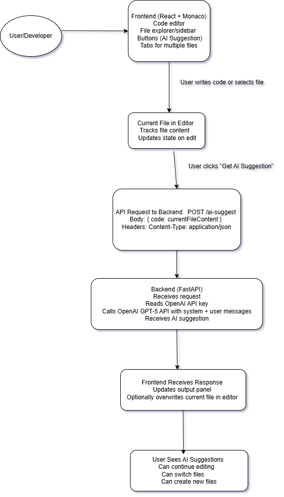

# AI-Powered Cloud IDE

A browser-based, VS Code-inspired editor with AI code suggestions. React + Monaco on the frontend, FastAPI on the backend, OpenAI (`gpt-4o-mini`) for suggestions.



## Features

- Monaco editor with a dark VS Code-like theme
- File explorer sidebar (resizable) with "New File", plus a tab strip
- **Get AI Suggestion** sends the current file to the backend, which asks OpenAI to improve it; the result opens in a side-by-side diff (Monaco `DiffEditor`) where you **Accept** or **Reject** it
- Backend file CRUD API (`/files`), currently stored in memory (lost on restart) and not yet used by the frontend
- `GET /health` for health checks

## Getting started

### Prerequisites

- Python 3.10+
- Node.js 20 + npm
- An OpenAI API key (only needed for AI suggestions; everything else runs without one)

### Backend

```bash
cd backend
python -m venv .venv
# Windows: .venv\Scripts\activate   macOS/Linux: source .venv/bin/activate
pip install -r requirements.txt
cp .env.example .env               # then set OPENAI_API_KEY in .env
                                   # or LLM_PROVIDER=fake to run offline
uvicorn main:app --reload          # http://127.0.0.1:8000
```

### Frontend

```bash
cd frontend
npm ci
npm start                          # http://localhost:3000
```

The frontend talks to the backend at `http://127.0.0.1:8000`.

### LLM configuration

| Variable | Default | Description |
| --- | --- | --- |
| `LLM_PROVIDER` | `openai` | `openai`, or `fake` for deterministic offline replies |
| `LLM_MODEL` | `gpt-4o-mini` | Model name passed to the provider |
| `OPENAI_API_KEY` | — | Required for the `openai` provider |

Providers live in `backend/llm/` behind a small `LLMProvider` interface, so new ones can be added without touching the endpoints.

## Running tests

```bash
# backend
cd backend
pip install -r requirements-dev.txt
python -m pytest

# frontend
cd frontend
CI=true npm test -- --watchAll=false
CI=true npm run build
```

Tests never call OpenAI; they use `FakeProvider` and no API key is needed. CI runs all of the above on every pull request.

## API

| Method | Path | Description |
| --- | --- | --- |
| GET | `/health` | `{"status": "ok"}` |
| POST | `/ai-suggest` | Body `{"code": str}` → `{"suggestion": str}`. Returns 503 if `OPENAI_API_KEY` is not set. |
| GET | `/files` | List file names |
| GET/PUT/DELETE | `/files/{filename}` | Read, update (`{"content": str}`), delete a file |
| POST | `/files` | Create a file (`{"filename": str, "content": str}`) |

## Contributing

Work is tracked as GitHub issues; see [CLAUDE.md](CLAUDE.md) for the conventions PRs should follow.

## Tech stack

- **Frontend**: React 19 (Create React App), `@monaco-editor/react`
- **Backend**: FastAPI, Uvicorn
- **AI**: OpenAI API (`gpt-4o-mini`)
